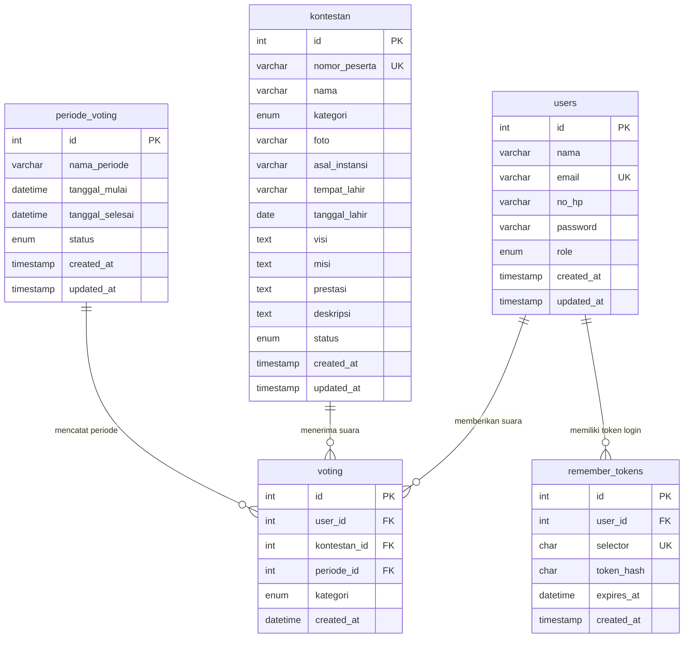

# Dokumentasi Struktur Database

Basis data aplikasi bernama `db_voting_kakang_senduk` dengan engine **InnoDB**, character set **utf8mb4**, dan collation **utf8mb4_unicode_ci**. Skema resmi tersimpan pada [database/db_voting_kakang_senduk.sql](../database/db_voting_kakang_senduk.sql).

---

## 1. Diagram Relasi Entitas (ERD)



---

## 2. Detail Tabel & Constraint

### A. Tabel `users`
Menyimpan akun Administrator dan Pemilih.

| Kolom | Tipe Data | Constraint | Keterangan |
| :--- | :--- | :--- | :--- |
| `id` | `INT UNSIGNED` | `PRIMARY KEY AUTO_INCREMENT` | ID unik pengguna |
| `nama` | `VARCHAR(100)` | `NOT NULL` | Nama lengkap |
| `email` | `VARCHAR(100)` | `NOT NULL, UNIQUE (uq_users_email)` | Email login (huruf kecil) |
| `no_hp` | `VARCHAR(20)` | `NOT NULL` | Nomor HP aktif |
| `password` | `VARCHAR(255)` | `NOT NULL` | Hash dari `password_hash()` |
| `role` | `ENUM('admin','pemilih')` | `NOT NULL DEFAULT 'pemilih'` | Hak akses pengguna |
| `created_at` | `TIMESTAMP` | `DEFAULT CURRENT_TIMESTAMP` | Waktu pendaftaran |
| `updated_at` | `TIMESTAMP` | `ON UPDATE CURRENT_TIMESTAMP` | Pembaruan terakhir |

**Index:** `uq_users_email (email)`, `idx_users_role (role)`, `idx_users_role_created_at (role, created_at)` (optimasi daftar pemilih & aktivitas terbaru).

### B. Tabel `kontestan`
Menyimpan profil lengkap finalis Kakang dan Senduk.

| Kolom | Tipe Data | Constraint | Keterangan |
| :--- | :--- | :--- | :--- |
| `id` | `INT UNSIGNED` | `PRIMARY KEY AUTO_INCREMENT` | ID kontestan |
| `nomor_peserta` | `VARCHAR(10)` | `NOT NULL, UNIQUE (uq_kontestan_nomor_peserta)` | Nomor urut kontestan |
| `nama` | `VARCHAR(100)` | `NOT NULL` | Nama lengkap finalis |
| `kategori` | `ENUM('Kakang','Senduk')` | `NOT NULL` | Kategori kompetisi |
| `foto` | `VARCHAR(255)` | `NULL` | Nama file unik di `uploads/kontestan/` |
| `asal_instansi` | `VARCHAR(150)` | `NOT NULL` | Sekolah / kampus / perwakilan |
| `tempat_lahir` | `VARCHAR(100)` | `NULL` | Tempat lahir |
| `tanggal_lahir` | `DATE` | `NULL` | Tanggal lahir |
| `visi`, `misi`, `deskripsi` | `TEXT` | `NOT NULL` | Profil & visi-misi finalis |
| `prestasi` | `TEXT` | `NULL` | Riwayat prestasi |
| `status` | `ENUM('Aktif','Nonaktif')` | `NOT NULL DEFAULT 'Aktif'` | Kontrol tampil & hak diterima suara |

**Index:** `uq_kontestan_nomor_peserta (nomor_peserta)`, `idx_kontestan_kategori_status (kategori, status)`, `idx_kontestan_nama (nama)`.

### C. Tabel `periode_voting`
Mengatur jadwal pelaksanaan pemungutan suara.

| Kolom | Tipe Data | Constraint | Keterangan |
| :--- | :--- | :--- | :--- |
| `id` | `INT UNSIGNED` | `PRIMARY KEY AUTO_INCREMENT` | ID periode |
| `nama_periode` | `VARCHAR(100)` | `NOT NULL` | Contoh: `Grand Final 2026` |
| `tanggal_mulai` | `DATETIME` | `NOT NULL` | Awal jadwal buka voting (WIB) |
| `tanggal_selesai` | `DATETIME` | `NOT NULL` | Batas akhir voting (WIB) |
| `status` | `ENUM('Aktif','Nonaktif')` | `NOT NULL DEFAULT 'Nonaktif'` | Sakelar aktivasi oleh admin |

**Index:** `idx_periode_status_waktu (status, tanggal_mulai, tanggal_selesai)`.

### D. Tabel `voting`
Mencatat suara sah pemilih yang bersifat **permanen**.

| Kolom | Tipe Data | Constraint | Keterangan |
| :--- | :--- | :--- | :--- |
| `id` | `INT UNSIGNED` | `PRIMARY KEY AUTO_INCREMENT` | ID transaksi suara |
| `user_id` | `INT UNSIGNED` | `FK -> users.id ON DELETE RESTRICT` | ID pemilih |
| `kontestan_id` | `INT UNSIGNED` | `FK -> kontestan.id ON DELETE RESTRICT` | ID kontestan penerima suara |
| `periode_id` | `INT UNSIGNED` | `FK -> periode_voting.id ON DELETE RESTRICT` | ID periode berjalan |
| `kategori` | `ENUM('Kakang','Senduk')` | `NOT NULL` | Kategori suara (`Kakang` / `Senduk`) |
| `created_at` | `DATETIME` | `NOT NULL DEFAULT CURRENT_TIMESTAMP` | Waktu server saat suara masuk |

**Integritas & Index:**
- `UNIQUE KEY uq_voting_user_periode_kategori (user_id, periode_id, kategori)` menjamin di tingkat mesin database bahwa seorang pemilih maksimal hanya memiliki 1 suara Kakang dan 1 suara Senduk per periode, bahkan ketika terjadi *concurrent requests*.
- `idx_voting_periode_kategori_kontestan (periode_id, kategori, kontestan_id)` bertindak sebagai *covering index* untuk query klasemen (`LEFT JOIN` + `COUNT`).
- `idx_voting_created_at (created_at)` mempercepat pengurutan log aktivitas dashboard admin.
- Seluruh foreign key memakai `ON DELETE RESTRICT` agar riwayat suara tidak pernah terhapus akibat penghapusan akun/kontestan/periode.

### E. Tabel `remember_tokens`
Menyimpan token persisten sesi opsional (*Ingat Saya*) secara aman.
- Menyimpan `selector` acak (`CHAR(32)`) dan `token_hash` SHA-256 (`CHAR(64)`).
- Relasi ke `users.id` menggunakan `ON DELETE CASCADE`.

---

## 3. Backup & Restore Database

### Backup Otomatis via Skrip CLI Bawaan
```bash
php database/backup.php
```
File SQL akan tersimpan secara aman di direktori terproteksi `database/backups/backup_db_voting_kakang_senduk_YYYYMMDD_His.sql`. Skrip ini hanya bisa dipanggil dari CLI dan akan mengembalikan `HTTP 403` jika diakses via browser.

### Backup & Restore via `mysqldump` / `mysql`
```bash
# Backup
mysqldump --single-transaction --routines --triggers -u USER_DB -p db_voting_kakang_senduk > backup_manual.sql

# Restore (Hanya lakukan setelah verifikasi & persetujuan pada lingkungan target)
mysql -u USER_DB -p db_voting_kakang_senduk < backup_manual.sql
```

